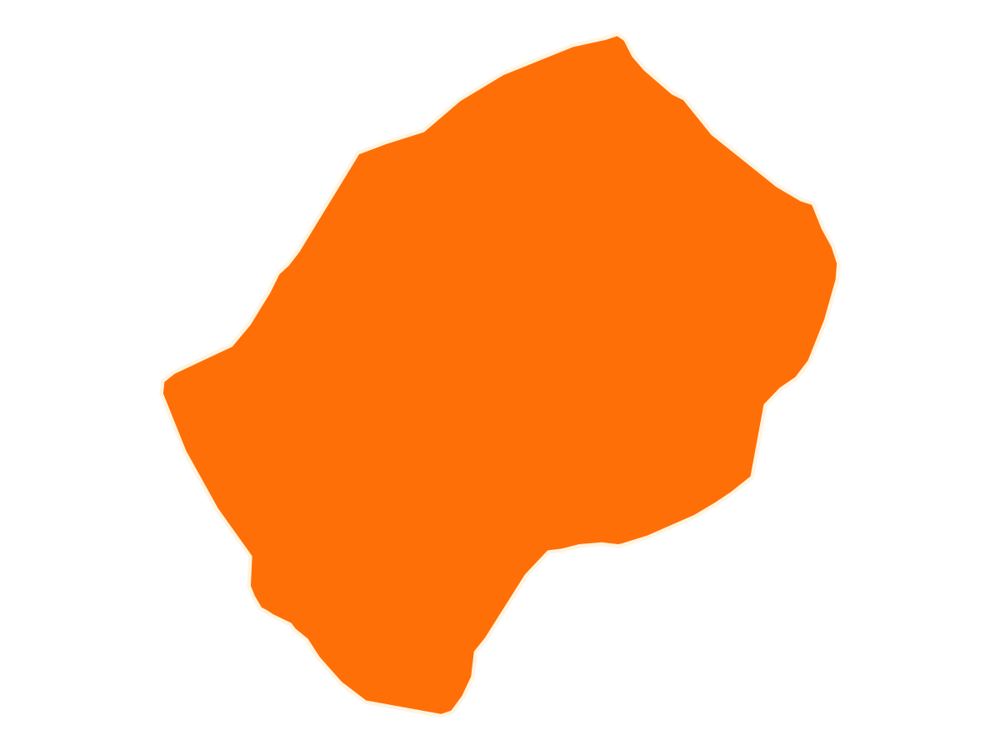
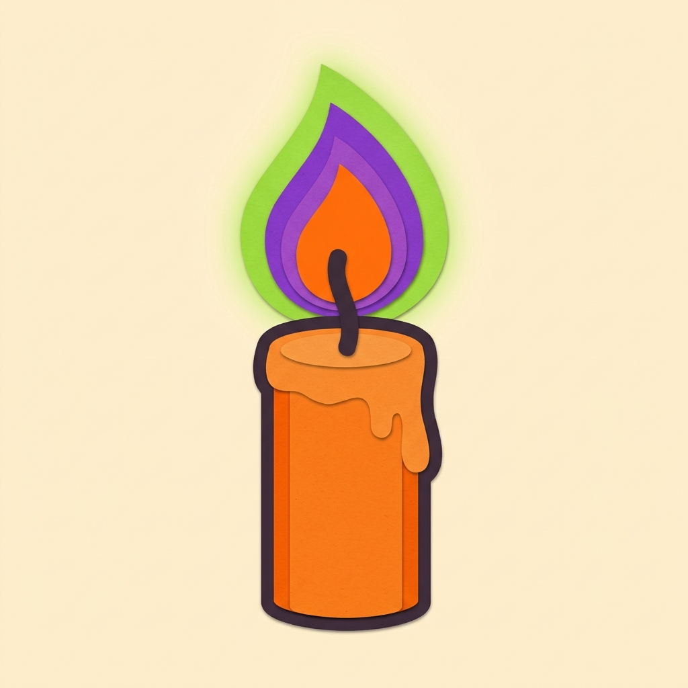

## Round 1: Geography 🌍 {.round background-color="#FF6F08"}

Round title card · `{.round background-color="#FF6F08"}`

## {.q}

::: {.qnum}
Question 1 · multiple choice
:::

::: {.prompt}
Which country spans the most time zones?
:::

::: {.options}
::: {.opt}
Russia
:::
::: {.opt}
USA
:::
::: {.opt}
France
:::
::: {.opt}
China
:::
:::

## {.q .ans}

::: {.qnum}
Answer slide · `.options.answered` + `.correct`
:::

::: {.prompt}
Which country spans the most time zones?
:::

::: {.options .answered}
::: {.opt}
Russia
:::
::: {.opt}
USA
:::
::: {.opt .correct}
France
:::
::: {.opt}
China
:::
:::

::: {.fact}
12 thanks to its overseas territories. China, 5,000 km wide, uses one.
:::

## {.q}

::: {.qnum}
Question 2 · picture + a row of options
:::

::: {.prompt}
Which country is this?
:::

::: {.qimg}

:::

::: {.options .row}
::: {.opt}
Eswatini
:::
::: {.opt}
Rwanda
:::
::: {.opt}
Burundi
:::
::: {.opt}
Lesotho
:::
:::

## {.q .ans}

::: {.qnum}
Question 3 · ordering
:::

::: {.prompt}
Put these bridges in order of opening, oldest first.
:::

::: {.options}
::: {.opt}
Golden Gate
:::
::: {.opt}
Øresund
:::
::: {.opt}
Brooklyn
:::
::: {.opt}
Sydney Harbour
:::
:::

::: {.answer}
C → D → A → B
:::

## {.q}

::: {.qnum}
Question 4 · rebus
:::

::: {.rebus}

::: {.txt}
ED
:::

::: {.txt}
4
:::

::: {.op}
+
:::

:::

## {.q}

::: {.qnum}
Song 1 · play it from Spotify, notes carry the answer
:::

::: {.song}
🎵
:::

::: {.notes}
Dancing On My Own - Robyn (2010). Start at 0:08.
:::

## Pens down 🖊️ {.round background-color="#872FE0"}

Answer section cards use purple
